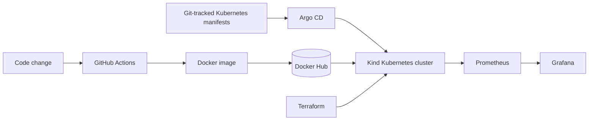

# FinanceApp


# Kubernetes CI/CD & GitOps Lab

**Automated Java application delivery with GitHub Actions, Docker, Terraform, Kubernetes (Kind), Argo CD, Prometheus, and Grafana.**

This project explores how to build, package, deploy, and observe a containerized application using a GitOps-oriented workflow. A **Java 17 / Spring Boot** service is the example workload; the main focus is the **delivery infrastructure**, not application business logic.

**Scope:** This is a local DevOps lab running on **Kind (Kubernetes in Docker)**, not a production or client deployment.

## What it demonstrates

- **CI:** Build and test a Maven application with GitHub Actions.
- **Container delivery:** Package the JAR into a Docker image and publish it to Docker Hub.
- **Infrastructure as code:** Use Terraform to manage the lab's infrastructure/bootstrap configuration.
- **Kubernetes deployment:** Run the containerized application in a local Kind cluster.
- **GitOps:** Manage desired Kubernetes application state in Git and reconcile it with Argo CD.
- **Observability:** Integrate Prometheus and Grafana into the lab's monitoring setup.

## Architecture



**Delivery model:** GitHub Actions handles CI and image publishing; Argo CD handles deployment reconciliation from Git. **Argo CD does not watch Docker Hub for new tags by itself.** A new image is deployed when its desired version is reflected in Git, or when a separately configured image-update integration changes that desired state.

## Technology stack

| Layer | Technology | Purpose |
| --- | --- | --- |
| Sample application | Java 17, Spring Boot, Maven | Application build and test workload |
| CI | GitHub Actions | Automated build, test, and image publishing |
| Containerization | Docker | Reproducible application packaging |
| Container registry | Docker Hub | Image distribution |
| Infrastructure | Terraform | Declarative lab configuration |
| Orchestration | Kubernetes, Kind | Local application deployment |
| Continuous delivery | Argo CD | GitOps reconciliation |
| Observability | Prometheus, Grafana | Metrics collection and visualization |

## Repository layout

```text
.
├── .github/workflows/      # CI workflows
├── Infrastructure files/   # Infrastructure and monitoring setup
├── manifests/              # Kubernetes / GitOps configuration
├── src/                    # Spring Boot application and tests
├── Dockerfile              # Java application image
├── pom.xml                 # Maven dependencies and build configuration
├── mvnw, mvnw.cmd          # Maven wrapper
└── README.md
```

## Run the application locally

**Prerequisites:** Java 17 and Docker. The Maven wrapper is included.

```bash
# Clone the repository
git clone https://github.com/Marrrco7/CI-CD-Kubernetes-Terraform-Docker-ArgoCD-GihubActions.git
cd CI-CD-Kubernetes-Terraform-Docker-ArgoCD-GihubActions

# Build and run tests
./mvnw clean verify

# Start the Spring Boot application
java -jar target/springboot-images.jar
```

The service runs on port `8080` by default. The application includes a `/greet` endpoint used in the project's HTTP test scenario:

```bash
curl http://localhost:8080/greet
```

To build its container image after Maven packaging:

```bash
docker build -t springboot-gitops-demo:local .
docker run --rm -p 8080:8080 springboot-gitops-demo:local
```

## Kubernetes and GitOps workflow

The infrastructure setup is **lab-specific** rather than a one-command production installer. To reproduce the full environment:

1. Install **Docker, Kind, kubectl, Terraform**, and access to a **Docker Hub** account.
2. Review the Terraform configuration under `Infrastructure files/` and initialize/apply it from its intended Terraform working directory. Avoid creating the Kind cluster twice if the configuration already provisions it.
3. Configure a GitHub Actions registry account/token using the secret names referenced in `.github/workflows/`.
4. Deploy the Kubernetes resources from `manifests/` and configure Argo CD to track the intended Git repository/path.
5. Ensure the image reference in the Git-tracked deployment configuration matches the version published to Docker Hub, or explicitly configure an image-update integration.
6. Verify application health and inspect metrics in Prometheus/Grafana.

Useful commands when the cluster is running:

```bash
kubectl get nodes
kubectl get pods -A
kubectl get deployments -A
kubectl get services -A
```

The exact Terraform working directory, workflow secrets, Argo CD application configuration, and monitoring access URLs depend on the configuration files in this repository; they are not represented here as generic copy-and-paste commands.

## Engineering considerations

**Why separate CI from CD?** CI produces and publishes a tested artifact. Argo CD independently reconciles the deployed Kubernetes state with version-controlled configuration. This makes desired state auditable and reduces reliance on imperative deployment commands inside CI.

**Image-update synchronization:** Publishing a new Docker image alone is insufficient to trigger Argo CD. Image-tag changes need to reach the GitOps source of truth (or be handled by a properly installed image updater). This was an important integration consideration during implementation.

**Monitoring:** Prometheus and Grafana are part of the lab architecture. For application-specific Prometheus metrics, the Spring Boot service would also need the appropriate exporter/instrumentation and scrape configuration; the Maven dependency list alone does not establish that end-to-end path.

## Limitations and next steps

- **Local environment:** Kind demonstrates Kubernetes deployment mechanics; this is not a managed production cluster.
- **Scaling:** Add Horizontal Pod Autoscaling and test it under load.
- **Release safety:** Add health-gated rollouts and a documented rollback strategy.
- **Observability:** Expand application-level metrics, dashboards, and alerting.
- **Security:** Keep kubeconfig files, certificates, private keys, and registry credentials out of Git; use secret storage and short-lived credentials where practical.
- **Reproducibility:** Document the exact bootstrap command sequence, required environment variables, and verified image-update mechanism.

## Project focus

The value of this project is the **end-to-end integration** of CI, container packaging, infrastructure configuration, GitOps-based delivery, and monitoring—not the complexity of the sample Spring Boot service.
